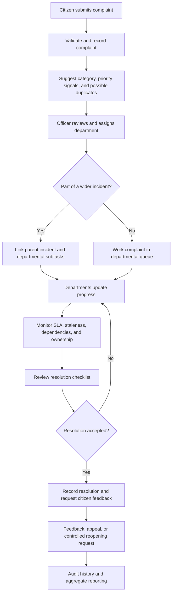

# CivicSarthi — Intelligent Civic Complaint & Incident Resolution System

**From Complaint to Resolution**

CivicSarthi is a civic grievance workflow and decision-support prototype that helps citizens submit and track complaints while helping public-service teams triage, coordinate, review, and monitor resolution work.

> **Independent prototype notice:** CivicSarthi is not affiliated with or endorsed by DARPG or CPGRAMS. Demo data may be synthetic. The application does not submit grievances to an official government portal unless a separately authorized integration is configured and verified.

- **Live demo:** https://civicsarthi-frontend.onrender.com/
- **Repository:** https://github.com/jiya25001126/CivicSarthi--Intelligent-Civic-Complaint-Incident-Resolution-System

## Contents

- [Why CivicSarthi](#why-civicsarthi)
- [What the system provides](#what-the-system-provides)
- [Key features](#key-features)
- [What is innovative](#what-is-innovative)
- [End-to-end workflow](#end-to-end-workflow)
- [User roles](#user-roles)
- [Technology stack](#technology-stack)
- [Architecture](#architecture)
- [Security, privacy, and responsible use](#security-privacy-and-responsible-use)
- [Run locally](#run-locally)
- [Configuration](#configuration)
- [Testing and production notes](#testing-and-production-notes)
- [Current limitations](#current-limitations)
- [Future roadmap](#future-roadmap)
- [Contributing](#contributing)

## Why CivicSarthi

Civic complaints often involve more than recording a ticket: a report may be assigned to the wrong department, duplicate reports may describe one larger incident, progress may stall without clear explanations, and a complaint may be marked resolved before the outcome is adequately checked. Citizens can also find internal administrative status labels difficult to understand.

CivicSarthi brings complaint handling, cross-department incident coordination, resolution checks, citizen feedback, appeals, and supervisory visibility into one prototype workflow. It is intended to complement authorized grievance systems, not replace official government channels or the judgment of public officials.

## What the system provides

- A citizen-facing interface for submitting, tracking, and reviewing complaints.
- Officer work queues for triage, status updates, departmental assignment, and internal notes.
- AI-assisted / rule-based complaint intelligence to support categorization, hazard-aware prioritization, and duplicate review.
- Parent incidents and departmental subtasks for related complaints that may need coordinated action.
- A Neglect Radar that surfaces explainable operational risk signals.
- Resolution-quality checks, feedback, appeals, and controlled reopening requests.
- Clarification requests, reminders, status explanations, and aggregate reporting tools.

## Key features

### 1. Complaint submission, tracking, and history

Citizens can submit a grievance, receive a reference, view their complaints, and follow the recorded lifecycle and history. Complaint status changes are validated by backend workflow rules rather than relying only on frontend controls.

### 2. AI-assisted complaint intelligence

The submission and triage workflow can suggest a complaint category, identify hazard-related priority signals, surface possible duplicates, and preview information for review. These capabilities are decision support: recommendations should be checked by a responsible person. The project should not be interpreted as a claim that every recommendation is produced by a trained machine-learning model.

### 3. Duplicate candidates, parent incidents, and subtasks

Reports that appear to describe the same civic event can be reviewed together as a parent incident. A larger event—such as flooding affecting roads and water services—can be coordinated through departmental subtasks. Propagation from an incident to linked complaints is controlled; incident resolution does not automatically modify every linked complaint unless the relevant workflow explicitly permits it.

### 4. Neglect Radar

The supervisory view highlights explainable signals that may indicate a complaint needs attention:

- `OVERDUE_SLA` — the resolution deadline has passed.
- `STALE_PROGRESS` — an update has not arrived within the configured interval.
- `BLOCKED_DEPENDENCY` — progress is waiting on a dependency.
- `REASSIGNMENT_LOOP` — repeated departmental reassignment may indicate ownership problems.
- `REOPENED_CASE` — a previously resolved case has reopened.
- `UNASSIGNED_OWNERSHIP` — no responsible owner is assigned.

Signals are intended to prioritize human review, not automatically prove negligence or misconduct.

### 5. Resolution Quality Checker

Before a complaint is treated as satisfactorily resolved, the workflow can validate a resolution checklist and required details. This helps identify incomplete resolution records and supports more consistent closure decisions.

### 6. Citizen feedback, appeals, and reopening

Eligible citizens can rate a resolution and provide comments. Appeals follow an explicit review lifecycle, with outcomes recorded for accountability. A successful appeal does not silently reopen a complaint. Reopening is a separate controlled request requiring the appropriate approval; negative feedback alone does not automatically reopen a case. Previous resolution milestones are retained for traceability.

### 7. Spam and suspicious-complaint review

Deterministic checks can flag patterns or suspicious submissions for human review. Flags are review signals, not definitive findings that a citizen has acted improperly.

### 8. Clarifications, reminders, and status translation

Citizens can request clarification where supported by the workflow, while reminders help bring pending actions back to attention. The status translator aims to explain administrative status in clearer, citizen-friendly language, including bilingual/plain-language support where configured.

### 9. Analytics and reporting

Aggregate views support monitoring of complaint volumes, statuses, department workloads, and operational trends. Supported reporting flows include CSV export and audit logging. Exported information should be handled according to the deployment's privacy and access policies.

### 10. Department operations and accountability

Officer workflows support scoped queues, triage, validated status transitions, reassignment, and confidential internal notes. Audit/history records help explain how a complaint moved through the system.

## What is innovative

| Common workflow challenge | CivicSarthi approach |
| --- | --- |
| Related reports are treated as isolated tickets | Parent incidents connect related complaints and coordinate departmental subtasks |
| Stalled work is noticed only after a citizen follows up | Neglect Radar surfaces configurable, explainable operational risk signals |
| A status label provides little practical explanation | Citizen-oriented status translation aims to make progress easier to understand |
| Closure can be recorded without a consistent quality check | A resolution checklist supports more disciplined closure review |
| Poor feedback may be confused with a reopening decision | Ratings, appeals, and reopening requests are separate, auditable workflows |
| Automated flags can be mistaken for final decisions | Suspicious cases and recommendations are designed to support human review |

The central idea is to connect **citizen communication, coordinated incident handling, resolution quality, and supervisory oversight** in a single workflow rather than treating complaint intake as the entire solution.

## End-to-end workflow



This diagram describes the intended supported workflow at a high level; exact screens and available actions depend on role, state, and deployment configuration.

## User roles

- **Citizen:** submit and track their own complaints, follow progress, request clarification, provide eligible feedback, and use available appeal/reopening workflows.
- **Officer:** review assigned or permitted departmental complaints, update status through allowed transitions, record internal notes, and coordinate work within their authorization.
- **Administrator / supervisor:** manage permitted assignments and review workflows, monitor operational risk and reporting, and perform privileged actions subject to backend authorization.

Access must be enforced by the backend; hiding a button in the frontend is not an authorization boundary.

## Technology stack

| Layer | Technologies / approach |
| --- | --- |
| Frontend | React, Vite, Tailwind CSS |
| Backend | Node.js, Express, ES modules, REST API |
| API prefix | `/api/v1` with legacy aliases where retained |
| Persistence | MongoDB/Mongoose when configured; JSON-file repository fallback for local/demo use |
| Validation and hardening | Zod validation, Helmet, CORS/rate-limit configuration, authentication and role checks |
| Workflow | Repository/service/controller separation, status-transition rules, SLA signals, audit/history records |
| Testing | Node.js test runner and frontend production build |
| Deployment options | Frontend hosting, backend hosting, and MongoDB Atlas or another configured MongoDB deployment |

## Architecture

The backend follows a layered approach to keep HTTP handling, business rules, and persistence responsibilities separate:

1. **Routes and middleware** expose API endpoints and apply validation/authentication controls.
2. **Controllers** translate HTTP requests and responses.
3. **Services** enforce workflow rules, role checks, business logic, and coordination.
4. **Repositories** read and write application records through the configured persistence implementation.
5. **Frontend pages** provide citizen, officer, and administrative workflows using the API.

The JSON repository fallback can make local demos easier to run without a database. For deployed multi-user use, configure and verify a persistent database and deployment-appropriate storage; do not assume local JSON files are durable across hosting restarts or multiple instances.

## Security, privacy, and responsible use

- Keep secrets in environment variables or the hosting provider's secret store; never commit real credentials, database passwords, or signing keys.
- Use a strong, unique production authentication secret and rotate any secret that has been exposed.
- Configure CORS, trusted proxy behavior, cookies, and frontend/backend origins for the actual deployment.
- Enforce role and ownership checks in backend routes and services.
- Treat internal notes and personal complaint details as confidential; return only data appropriate to the requesting role.
- Apply rate limits and input validation to public-facing endpoints.
- Keep audit events useful for accountability without unnecessarily copying sensitive data into logs.
- Use synthetic/demo records for demonstrations and obtain authorization before processing real citizen data.
- Review exports before sharing them; CSV files can contain personal or sensitive information.
- Human reviewers should make final decisions about priority, suspicious submissions, negligence, appeals, and resolution quality.

These are design and operational principles, not a substitute for an independent security audit or legal/privacy review of a production deployment.

## Run locally

### Prerequisites

- Node.js and npm versions compatible with the repository's `package.json` files.
- Git.
- MongoDB is optional for local development when the JSON fallback is configured; a MongoDB connection is needed if you choose MongoDB persistence.

### 1. Clone the repository

```bash
git clone https://github.com/jiya25001126/CivicSarthi--Intelligent-Civic-Complaint-Incident-Resolution-System.git
cd CivicSarthi--Intelligent-Civic-Complaint-Incident-Resolution-System
```

### 2. Install dependencies

From the repository root, use the project install script if available:

```bash
npm run install:all
```

On Windows PowerShell, if the execution policy blocks the npm PowerShell shim, use `npm.cmd`:

```powershell
npm.cmd run install:all
```

If the repository's install script is unavailable, install dependencies from the root and the relevant package directories according to their `package.json` files.

### 3. Configure environment variables

Copy `.env.example` to `.env` if the example file exists, then edit values for your environment. Never commit the resulting secret-bearing `.env` file.

### 4. Start the backend

```bash
cd backend
npm install
npm run dev
```

The local backend has historically used `http://localhost:5000`; confirm the actual port from your environment. The health endpoint is typically `/api/v1/health`.

### 5. Start the frontend

In a second terminal:

```bash
cd frontend
npm install
npm run dev
```

The local Vite development server has historically used `http://localhost:5173`. Follow the URL printed by Vite if it selects another port.

### 6. Run tests and build

From the repository root, or from the relevant package directory:

```bash
npm --prefix backend test
npm --prefix frontend run build
```

On Windows, use `npm.cmd` if needed:

```powershell
npm.cmd --prefix backend test
npm.cmd --prefix frontend run build
```

**Data safety:** do not run seed/reset scripts against a working dataset unless you have inspected the script and intentionally want its effects. Back up local JSON data and database data before destructive maintenance.

## Configuration

Actual supported variables and defaults are defined by the current source and environment example. Common configuration areas include:

| Variable / setting | Purpose |
| --- | --- |
| `NODE_ENV` | Selects development or production behavior |
| `PORT` / `HOST` | Backend bind configuration |
| `MONGODB_URI` | MongoDB connection URI; keep credentials private |
| `FRONTEND_ORIGIN` | Allowed frontend origin for CORS |
| `VITE_API_URL` | API base URL used by the frontend when configured |
| `JWT_SECRET` and token/session settings | Authentication signing/session configuration, if enabled by the selected auth implementation |
| `TRUST_PROXY` and cookie settings | Deployment-specific proxy and cookie behavior |
| AI-provider keys | Only required if a configured feature actually calls that provider; keep them server-side |

Do not assume every variable above is required or enabled in every deployment. Check `.env.example`, application configuration, and deployment settings before changing production values.

## Testing and production notes

Before a release, run the backend test suite and frontend build, verify the health endpoint, and exercise the main citizen and officer flows using non-production demo data. Also test role boundaries, invalid status transitions, database connectivity, error handling, and audit behavior.

For a public deployment, configure persistent storage, HTTPS, environment secrets, allowed origins, backups, monitoring, and a documented recovery procedure. A successful health response alone does not prove that authentication, writes, or all application workflows are working end to end.

Demo access, where available, should be obtained through the application's demo interface or from the project maintainer. Do not publish shared demo passwords or production credentials in this README.

## Current limitations

- CivicSarthi is a prototype and is not an official government grievance portal.
- No official CPGRAMS/DARPG integration should be assumed; any future integration requires authorization, technical verification, and appropriate agreements.
- Classification, duplicate candidates, risk signals, and suspicious-submission flags support human decisions and can be wrong.
- Available features depend on the deployed revision, environment variables, configured database, and user role.
- A local JSON fallback is suitable for development/demo scenarios, not a replacement for carefully configured durable production storage.
- This README does not claim independent security certification, formal government adoption, or guaranteed resolution-time improvements.

## Future roadmap

The following are **potential future enhancements**, not claims of current implementation:

- Voice-based complaint filing with speech recognition and confirmation before submission.
- Computer-vision assistance for optional civic-issue photos, with privacy safeguards and human verification.
- Authorized SMS, WhatsApp, email, or other notification channels with consent and delivery monitoring.
- An officially authorized adapter for government grievance systems, subject to approvals and API availability.
- Map-based incident visualization and geographic clustering where reliable location data and permissions are available.
- Broader multilingual accessibility and usability testing with diverse citizens.
- Predictive workload and SLA-risk analytics, evaluated for reliability and bias before operational use.
- Improved monitoring, deployment automation, backup/restore drills, and independent security/accessibility reviews.
- Citizen communication improvements based on feedback and measured usability.

## Contributing

Contributions and issue reports are welcome. Before submitting a change:

1. Explain the problem and intended behavior.
2. Keep authorization and privacy checks on the backend.
3. Add or update tests for workflow and access-control changes.
4. Avoid committing secrets, personal data, generated runtime records, or local environment files.
5. Document limitations honestly and distinguish implemented behavior from proposed work.

## License and notice

Check the repository's existing license file before redistributing or reusing this project. Unless a license is present and clearly applies, do not assume that the code is open-source licensed.

*CivicSarthi is an independent civic innovation prototype. It is not affiliated with or endorsed by DARPG/CPGRAMS.*
