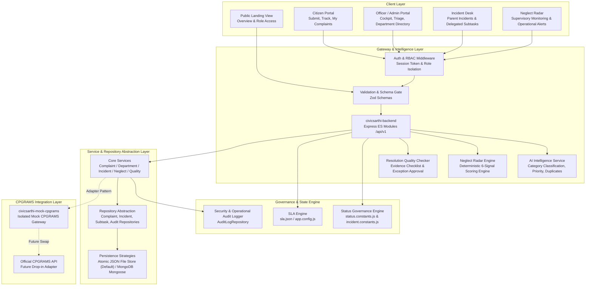

# CivicSarthi Architecture Document

> **"CivicSarthi: Intelligent decision-support and civic incident resolution layer for grievance redressal systems."**  
> *Tagline: "From Complaint to Resolution."*

---

## 1. Overview & System Mission

**CivicSarthi** is an intelligent decision-support and workflow coordination layer designed to augment civic complaint redressal systems like the Centralised Public Grievance Redress and Monitoring System (CPGRAMS). Rather than replacing or fragmenting existing national grievance infrastructure, CivicSarthi operates as an intelligent assistive layer for citizens and nodal officers.

### System Transparency & Notice
> **Notice:** CivicSarthi is an independent civic resolution platform and is not affiliated with or endorsed by DARPG/CPGRAMS. All data used during testing and demonstrations is synthetic. This application does not submit grievances directly to official government portals without authorization.

---

## 2. High-Level System Architecture

---

## 3. Layer Descriptions

### 3.1 Frontend (`/frontend`)
- **Package**: `civicsarthi-frontend`
- **Tech Stack**: React 18, Vite 6, Tailwind CSS, Axios, Lucide React, Recharts.
- **Route Matrix**:
  - `/` &mdash; Public Landing Page (hero, system pillars, live metrics, GovTech transparency notice).
  - `/login` & `/register` &mdash; Authentication views with demo quick-login credentials.
  - `/citizen` &mdash; Citizen Overview Dashboard (KPIs, recent cases, quick links).
  - `/citizen/submit` &mdash; Complaint Submission Form with real-time AI Assistive Preview.
  - `/citizen/complaints` &mdash; My Complaints Page (multi-filter search, sorting, table).
  - `/citizen/track` & `/citizen/track/:id` &mdash; Grievance Status Tracker with audit timeline, parent incident context, and sanitized resolution proof.
  - `/citizen/complaints/:id` &mdash; Detailed Grievance View (narrative, metadata, SLA health, sanitized resolution details).
  - `/officer` &mdash; Officer Executive Cockpit (caseload stats, department workload, attention queue).
  - `/officer/complaints` &mdash; Officer Complaint Management (multi-criteria triage, department filters, SLA health pills).
  - `/officer/complaints/:id` &mdash; Officer Review Desk (status transitions, resolution quality gate, AI intelligence cards, duplicate linking, notes).
  - `/officer/departments` &mdash; Department Management Directory (active nodes, SLA targets, caseload distribution).
  - `/officer/incidents` (`/incident`) &mdash; Multi-Agency Incident Management Desk (Phase 7: parent incident clustering, subtask delegation, cascade resolutions).
  - `/officer/neglect-radar` (`/neglect-radar`) &mdash; Supervisory Neglect Radar (Phase 8: explainable risk scores, stalled case detection, playbooks).
  - `/status-translator` &mdash; Plain-language civic status translator preview (Phase 12).

### 3.2 Backend API (`/backend`)
- **Package**: `civicsarthi-backend`
- **Runtime**: Node.js (v20+ / v24+), Express (ES modules).
- **REST Endpoints**: Standardized under `/api/v1` with backward-compatible aliases under `/api`.
  - `/api/v1/auth` &mdash; Authentication, registration, current session context.
  - `/api/v1/complaints` &mdash; Grievance submission, tracking, triage, status updates, notes, AI analysis, duplicate linking.
  - `/api/v1/departments` &mdash; Department catalog and caseload metrics.
  - `/api/v1/incidents` &mdash; Parent incident creation, retrieval, status progression, complaint linking, and nested subtasks.
  - `/api/v1/subtasks` &mdash; Multi-agency delegated subtasks and department-scoped status progression.
  - `/api/v1/neglect-radar` &mdash; Supervisory operational monitoring, 6-signal risk scores, summary metrics.
  - `/api/v1/admin` &mdash; System security audit logs and administrative operations.
- **Design Pattern**: Controller &rarr; Service &rarr; Repository pattern.
  - Controllers manage HTTP serialization and error reporting.
  - Services execute business rules, SLA health metrics, and workflow logic.
  - Repositories encapsulate all data access behind an asynchronous persistence interface.
- **Security & Reliability**:
  - `helmet`: Secure HTTP response headers.
  - `cors`: Restricted to configured frontend origin.
  - `express-rate-limit`: Protects authentication and public endpoints.
  - `zod`: Request schema parameter and query validation.
  - Centralized error handler capturing structured JSON responses.

### 3.3 Database Strategy & Local Fallback
- **MongoDB Connection**: Handled via Mongoose in `src/config/database.js` when `MONGODB_URI` is provided in `.env`.
- **Local Development Fallback**: If MongoDB is unavailable or `MONGODB_URI` is unset, the system gracefully falls back to a persistent JSON file-backed repository (`data/complaints.json`, `data/departments.json`, `data/status_history.json`, `data/incidents.json`, `data/subtasks.json`, `data/audit_logs.json`).
- **No In-Memory Loss**: All grievance creations, status changes, and notes made during demo runs persist cleanly to disk.
- **Concurrency Protection**: Mutex-locked file persistence (`AsyncMutex`) prevents race conditions and lost updates during parallel writes.

### 3.4 Governance & Status Transition Rules
Status progression follows strict administrative rules defined in `src/constants/status.constants.js`:
- `SUBMITTED` &rarr; `UNDER_REVIEW`, `ASSIGNED`, `CLOSED`
- `UNDER_REVIEW` &rarr; `ASSIGNED`, `IN_PROGRESS`, `AWAITING_INFORMATION`, `CLOSED`
- `ASSIGNED` &rarr; `IN_PROGRESS`, `UNDER_REVIEW`, `AWAITING_INFORMATION`
- `IN_PROGRESS` &rarr; `AWAITING_INFORMATION`, `RESOLVED`, `CLOSED`, `ASSIGNED`
- `AWAITING_INFORMATION` &rarr; `UNDER_REVIEW`, `IN_PROGRESS`, `CLOSED`
- `RESOLVED` &rarr; `CLOSED`, `REOPENED`
- `CLOSED` &rarr; `REOPENED`
- `REOPENED` &rarr; `UNDER_REVIEW`, `ASSIGNED`, `IN_PROGRESS`

Any disallowed transition is rejected with `400 Bad Request` and returns the list of permissible target states.

### 3.5 Incident & Subtask Governance
Status progressions defined in `src/constants/incident.constants.js`:
- **Parent Incident Lifecycle:**
  - `ACTIVE` &rarr; `CONTAINED`, `RESOLVED`, `CLOSED`
  - `CONTAINED` &rarr; `ACTIVE`, `RESOLVED`, `CLOSED`
  - `RESOLVED` &rarr; `CONTAINED`, `CLOSED`
  - `CLOSED` &rarr; Terminal state
- **Department Subtask Lifecycle:**
  - `PENDING` &rarr; `IN_PROGRESS`, `CANCELLED`
  - `IN_PROGRESS` &rarr; `COMPLETED`, `PENDING`, `CANCELLED`
  - `COMPLETED` &rarr; Terminal state
  - `CANCELLED` &rarr; Terminal state

### 3.6 Isolated Mock CPGRAMS Service (`/mock-cpgrams`)
- **Package**: `civicsarthi-mock-cpgrams`
- **Isolation**: A completely decoupled module simulating official CPGRAMS endpoints:
  - `GET /complaints`: List complaints with official filters.
  - `GET /complaints/:id`: Fetch specific complaint by registration ID.
  - `PATCH /complaints/:id/status`: Update official status string and remarks.
- Provides `MockCpgramsClient` adapter ready to be replaced with the real CPGRAMS portal API in the future.

---

## 4. SLA & Configuration Engine

SLA rules are loaded externally from `src/config/sla.json` and `src/config/app.config.js`:
- `resolutionDeadlineDays` (default 30): Target completion SLA.
- `staleUpdateDays` (default 7): Days without touch before flagged as stale.
- `reassignmentLoopThreshold` (default 2): Department handoff threshold triggering loop alerts.

These thresholds are evaluated dynamically on fetch and are never hardcoded.

---

## 5. Revised 16-Phase Implementation Architecture & Roadmap

1. **Phase 0: Repository migration, branding, and revised documentation.**  
   Initial repository rebranding, architecture specification, directory structure, and foundational migration reports.
2. **Phase 1: Audit and stabilization of the existing application.**  
   Code audit, baseline stability fixes, core API routes, synthetic seed dataset, and test scaffolding.
3. **Phase 2: Data model and persistence improvements.**  
   Dual-persistence abstraction (mutex-protected JSON and Mongoose MongoDB), schema validations, anti-silent fallback guards.
4. **Phase 3: Authentication, sessions, and role-based access control.**  
   Token-based session management, RBAC (`citizen`, `officer`, `admin`), route guards, and department scoping.
5. **Phase 4: Citizen grievance submission and tracking.**  
   Citizen submission portal, reference generation (`CS-2026-XXXX`), public tracking timeline, and PII protection allowlists.
6. **Phase 5: Officer operations and department workflow.**  
   Departmental triage queues, status transition enforcement, internal notes isolation, and administrative reassignment auditing.
7. **Phase 6: AI complaint intelligence, classification, explainable priority recommendations, and duplicate detection.**  
   Category classification, hazard-based priority recommendations, multi-signal duplicate candidate detection, and citizen draft preview.
8. **Phase 7: Parent incidents and department subtasks.**  
   Composite parent incidents, multi-agency subtask delegation, dual-write compensation rollback, and cascade resolutions.
9. **Phase 8: Neglect Radar and supervisory alerts.**  
   Explainable 6-signal supervisory risk scoring, bottleneck detection, department scoping, and operational playbooks.
10. **Phase 9: Resolution Quality Checker.**  
    Gated complaint resolution, verification method checklists, physical repair photo evidence validation, and admin exception approvals.
11. **Phase 10: Citizen resolution feedback, appeals, and grievance ratings.**  
    Citizen satisfaction ratings, grievance reopening workflows, and formal dispute appeal escalation desks.
12. **Phase 11: Spam/fake complaint detection with human review.**  
    Automated spam heuristic scoring, flag queues, citizen reputation tracking, and human-in-the-loop review desks.
13. **Phase 12: Citizen-initiated clarification/reminders and Status Translator.**  
    Citizen information request workflows, reminder throttling, and AI-assisted plain-language status translation.
14. **Phase 13: Aggregate analytics and reporting.**  
    Municipal KPI dashboards, departmental SLA compliance reporting, geographical trend aggregation, and executive exports.
15. **Phase 14: Security, accessibility, testing, and deployment readiness.**  
    WCAG 2.1 AA accessibility audit, penetration testing, production containerization, and automated CI/CD pipeline.
16. **Phase 15: Optional voice, computer vision, notifications, and authorized integrations.**  
    Multilingual voice grievance filing, automated damage computer vision analysis, SMS/WhatsApp alerts, and authorized CPGRAMS sync.

---

## 6. Project Implementation Status Table

| Phase | Phase Title | Status | Report Link | Evidence & Test Metrics |
| :---: | :--- | :---: | :--- | :--- |
| **0** | Repo Migration & Revised Roadmap | **VERIFIED** | [phase0-report.md](file:///docs/phase0-report.md) | Baseline scaffold, CPGRAMS mock adapter, docs |
| **1** | Audit & Platform Stabilization | **VERIFIED** | [phase1-report.md](file:///docs/phase1-report.md) | 24 core API tests pass |
| **2** | Persistence & Data Model Hardening | **VERIFIED** | [phase2-report.md](file:///docs/phase2-report.md) | 14 persistence tests pass; mutex file storage |
| **3** | Authentication, Sessions & RBAC | **VERIFIED** | [phase3-report.md](file:///docs/phase3-report.md) | 18 auth tests pass; role isolation verified |
| **4** | Citizen Submission & Tracking | **VERIFIED** | [phase4-report.md](file:///docs/phase4-report.md) | 18 citizen tests pass; tracking PII stripped |
| **5** | Officer Operations & Workflow | **VERIFIED** | [phase5-report.md](file:///docs/phase5-report.md) | 74 regression tests pass; triage cockpit live |
| **6** | AI Intelligence & Duplicate Detection | **VERIFIED** | [phase6-report.md](file:///docs/phase6-report.md) | 31 intelligence tests pass; classifier live |
| **7** | Parent Incidents & Subtasks | **VERIFIED** | [phase7-report.md](file:///docs/phase7-report.md) | 93 incident tests pass; IncidentPage live |
| **8** | Neglect Radar & Supervisory Alerts | **VERIFIED** | [phase8-report.md](file:///docs/phase8-report.md) | 54 neglect radar tests pass; Radar cockpit live |
| **9** | Resolution Quality Checker | **VERIFIED** | [phase9-report.md](file:///docs/phase9-report.md) | 57 quality tests pass; resolution gate live |
| **10** | Citizen Feedback & Appeals | **VERIFIED** | [phase10-report.md](file:///docs/phase10-report.md) | 28 feedback/appeal/reopening tests pass; full suite 337 tests pass; review desks live |
| **11** | Spam/Fake Detection & Review | **VERIFIED** | [phase11-report.md](file:///docs/phase11-report.md) | 27 spam/reputation/review tests pass; full suite 364 tests pass; review cockpit live |
| **12** | Reminders & Status Translator | **VERIFIED** | [phase12-report.md](file:///docs/phase12-report.md) | 24 clarification/reminder/translator tests pass; full suite 388 tests pass; translator live |
| **13** | Aggregate Analytics & Reporting | **VERIFIED** | [phase13-report.md](file:///docs/phase13-report.md) | 21 analytics/trends/export tests pass; full suite 409 tests pass; analytics dashboard live |
| **14** | Security, A11y & Deployment | **VERIFIED** | [phase14-report.md](file:///docs/phase14-report.md) | 24 security/RBAC/probe tests pass; full suite 433 tests pass; WCAG 2.2 AA & Docker ready |
| **15** | Voice, Vision & Integrations | *PLANNED* | &mdash; | Roadmap scope defined; not yet implemented |

> **Summary Test Metrics:** Across Phases 1 through 14, **433 automated backend tests across 92 suites pass with 0 failures**. Frontend production build compiles cleanly in Vite (2,278 modules transformed, 0 errors).

---

## 7. Security & Privacy Guarantees
- **Synthetic Data**: All seed data is 100% synthetic (fictitious names, anonymized IDs, mock contact addresses).
- **Environment Isolation**: `.env` and sensitive configurations are strictly excluded via `.gitignore`.
- **Input Validation & Traversal Defenses**: All requests are validated against strict Zod schemas before reaching business logic; evidence filenames reject directory traversal (`../`).
- **Pre-commit Audit**: Zero API secrets, keys, or internal credentials committed to version control.
- **HTTP Security & Headers**: Helmet Content Security Policy, X-Frame-Options DENY, X-Content-Type-Options nosniff, and Permissions-Policy enabled on all responses.
- **Data Scoping & Tenant Isolation**: Citizens cannot view or access other citizens' complaints; officers are strictly restricted to their assigned department. Internal officer notes are excluded from citizen endpoints.
- **CSV Formula Injection Safeguards (CWE-1236)**: Cells beginning with spreadsheet formula triggers (`=`, `+`, `-`, `@`, `\t`, `\r`) are escaped with a leading single quote.

