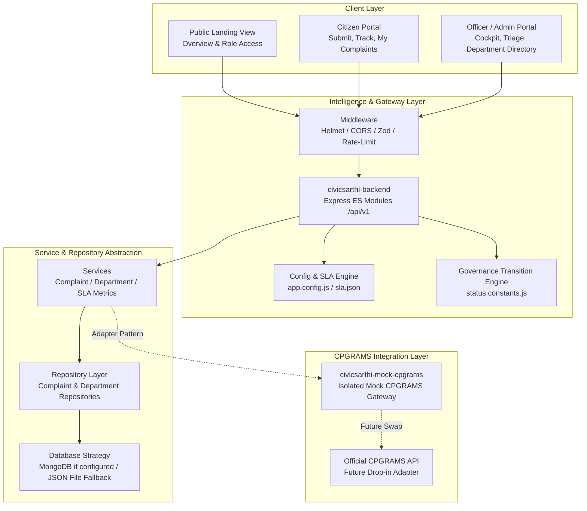

# CivicSarthi Architecture Document

> **"CivicSarthi: Intelligent decision-support and civic incident resolution layer for grievance redressal systems."**  
> *Tagline: "From Complaint to Resolution."*

---

## 1. Overview & System Mission

**CivicSarthi** is an intelligent decision-support and workflow coordination layer designed to augment civic complaint redressal systems like the Centralised Public Grievance Redress and Monitoring System (CPGRAMS). Rather than replacing or fragmenting the existing national grievance infrastructure, CivicSarthi operates as an intelligent assistive layer for citizens and nodal officers.

### System Transparency & Notice
> **Notice:** CivicSarthi is an independent civic resolution platform and is not affiliated with or endorsed by DARPG/CPGRAMS. All data used during testing and demonstrations is synthetic. This application does not submit grievances directly to official government portals without authorization.

---

## 2. High-Level System Architecture

---

## 3. Layer Descriptions

### 3.1 Frontend (`/frontend`)
- **Package**: `civicsarthi-frontend`
- **Tech Stack**: React 18, Vite 6, Tailwind CSS, Axios, Lucide React, Recharts.
- **Role Switcher**: Demonstrates public, citizen, and officer access states clearly labelled as demo role selection.
- **Route Matrix**:
  - `/` &mdash; Public Landing Page (hero, system pillars, live metrics, GovTech transparency notice).
  - `/citizen` &mdash; Citizen Overview Dashboard (KPIs, recent cases, quick links).
  - `/citizen/submit` &mdash; Complaint Submission Form (live validation, reference number generation `CS-2026-XXXX`).
  - `/citizen/complaints` &mdash; My Complaints Page (multi-filter search, sorting, table).
  - `/citizen/track` & `/citizen/track/:id` &mdash; Grievance Status Tracker (visual audit timeline).
  - `/citizen/complaints/:id` &mdash; Detailed Grievance View (narrative, metadata, SLA health, attachments).
  - `/officer` &mdash; Officer Cockpit (caseload stats, attention queue, bottleneck indicators).
  - `/officer/complaints` &mdash; Officer Complaint Management (multi-criteria triage, department filters).
  - `/officer/complaints/:id` &mdash; Officer Review Desk (status transitions, department reassignment, internal notes).
  - `/officer/departments` &mdash; Department Management Directory (active nodes, SLA targets, caseload distribution).
  - `/incident`, `/neglect-radar`, `/status-translator` &mdash; Flagship feature preview placeholders (Phases 7, 8, 12).

### 3.2 Backend API (`/backend`)
- **Package**: `civicsarthi-backend`
- **Runtime**: Node.js (v20+ / v24+), Express (ES modules).
- **REST Endpoints**: Standardized under `/api/v1` with backward-compatible aliases under `/api`.
- **Design Pattern**: Controller &rarr; Service &rarr; Repository pattern.
  - Controllers manage HTTP serialization and error reporting.
  - Services execute business rules, SLA health metrics, and workflow logic.
  - Repositories encapsulate all data access behind an asynchronous persistence interface.
- **Security & Reliability**:
  - `helmet`: Secure HTTP response headers.
  - `cors`: Restricted to configured frontend origin.
  - `express-rate-limit`: Protects endpoints against denial-of-service.
  - `zod`: Request schema parameter and query validation.
  - Centralized error handler capturing structured JSON responses.

### 3.3 Database Strategy & Local Fallback
- **MongoDB Connection**: Handled via Mongoose in `src/config/database.js` when `MONGODB_URI` is provided in `.env`.
- **Local Development Fallback**: If MongoDB is unavailable or `MONGODB_URI` is unset, the system gracefully falls back to a persistent JSON file-backed repository (`data/complaints.json`, `data/departments.json`, `data/status_history.json`).
- **No In-Memory Loss**: All grievance creations, status changes, and notes made during demo runs persist cleanly to disk.

### 3.4 Governance & Status Transition Rules
Status progression follows strict administrative rules defined in `src/constants/status.constants.js`:
- `SUBMITTED` &rarr; `UNDER_REVIEW`, `ASSIGNED`, `CLOSED`
- `UNDER_REVIEW` &rarr; `ASSIGNED`, `IN_PROGRESS`, `AWAITING_INFORMATION`, `CLOSED`
- `ASSIGNED` &rarr; `IN_PROGRESS`, `UNDER_REVIEW`, `AWAITING_INFORMATION`
- `IN_PROGRESS` &rarr; `AWAITING_INFORMATION`, `RESOLVED`, `CLOSED`, `ASSIGNED`
- `AWAITING_INFORMATION` &rarr; `UNDER_REVIEW`, `IN_PROGRESS`, `CLOSED`
- `RESOLVED` &rarr; `CLOSED`, `REOPENED`
- `CLOSED` &rarr; `REOPENED`
- `REOPENED` &rarr; `UNDER_REVIEW`, `ASSIGNED`, `IN_PROGRESS`

Any disallowed transition is rejected with `400 Bad Request` and returns the list of permissible target states.

### 3.5 Isolated Mock CPGRAMS Service (`/mock-cpgrams`)
- **Package**: `civicsarthi-mock-cpgrams`
- **Isolation**: A completely decoupled module simulating official CPGRAMS endpoints:
  - `GET /complaints`: List complaints with official filters.
  - `GET /complaints/:id`: Fetch specific complaint by registration ID.
  - `PATCH /complaints/:id/status`: Update official status string and remarks.
- Provides `MockCpgramsClient` adapter ready to be replaced with the real CPGRAMS portal API in the future.

---

## 4. SLA & Configuration Engine

SLA rules are loaded externally from `src/config/sla.json` and `src/config/app.config.js`:
- `resolutionDeadlineDays` (default 30): Target completion SLA.
- `staleUpdateDays` (default 7): Days without touch before flagged as stale.
- `reassignmentLoopThreshold` (default 2): Department handoff threshold triggering loop alerts.

These thresholds are evaluated dynamically on fetch and are never hardcoded.

---

## 5. Revised 16-Phase Implementation Architecture

1. **Phase 0**: Repository migration, branding and revised documentation.
2. **Phase 1**: Audit and stabilize the existing application.
3. **Phase 2**: Data model and persistence improvements.
4. **Phase 3**: Authentication, sessions and role-based access control.
5. **Phase 4**: Citizen grievance submission and tracking.
6. **Phase 5**: Officer operations and department workflow.
7. **Phase 6**: AI complaint intelligence, classification, explainable priority recommendations and duplicate detection.
8. **Phase 7**: Parent incidents and department subtasks.
9. **Phase 8**: Neglect Radar and supervisory alerts.
10. **Phase 9**: Resolution Quality Checker.
11. **Phase 10**: Citizen resolution feedback, appeals and grievance ratings.
12. **Phase 11**: Spam/fake complaint detection with human review.
13. **Phase 12**: Citizen-initiated clarification requests, reminders and Status Translator.
14. **Phase 13**: Aggregate analytics and reporting.
15. **Phase 14**: Security, accessibility, testing and deployment readiness.
16. **Phase 15**: Optional extensions (multimodal, notifications, external integrations).

---

## 6. Security & Privacy Guarantees
- **Synthetic Data**: All seed data is 100% synthetic (fictitious names, anonymized IDs, mock contact addresses).
- **Environment Isolation**: `.env` and sensitive configurations are strictly excluded via `.gitignore`.
- **Input Validation**: All requests are validated against strict Zod schemas before reaching business logic.
- **Pre-commit Audit**: Zero API secrets, keys, or internal credentials committed to version control.
