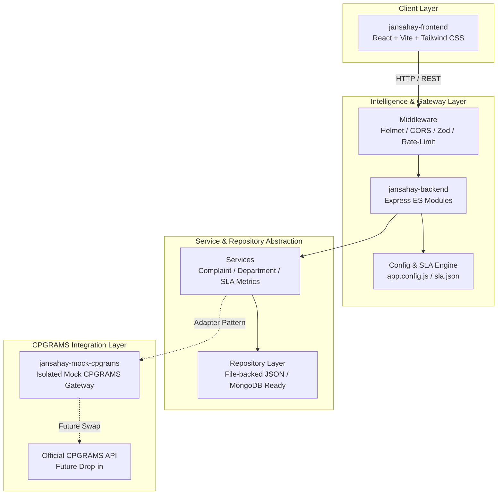

# JanSahay Architecture Document

> **"JanSahay: AI-assisted grievance resolution layer for CPGRAMS."**  
> *Tagline: "From Complaint to Resolution"*

---

## 1. Overview & System Mission

**JanSahay** is an AI workflow and decision-support layer designed to operate seamlessly on top of India's Centralised Public Grievance Redress and Monitoring System (CPGRAMS). Rather than replacing or fragmenting the existing national grievance portal, JanSahay acts as an intelligent assistive co-pilot for citizens and nodal officers.

### Legal Notice & Prototype Disclaimer
> **Disclaimer:** JanSahay is a prototype and is not affiliated with or endorsed by DARPG/CPGRAMS. All data used during testing and demonstrations is synthetic.

---

## 2. High-Level System Architecture

---

## 3. Layer Descriptions

### 3.1 Frontend (`/frontend`)
- **Package**: `jansahay-frontend`
- **Tech Stack**: React 18, Vite 6, Tailwind CSS, Lucide React, Recharts.
- **Role Switcher**: Toggles between Citizen and Officer modes.
- **Route Matrix**:
  - `/` — Citizen Dashboard (grievance search, tracking, status badges).
  - `/officer` — Officer Triage Cockpit (SLA health, triage table, handoff counts).
  - `/complaints/:id` — Complaint Detail view (SLA diagnosis, evidence citations, history).
  - `/incident` — Parent Incident clustering (multi-department coordination preview).
  - `/neglect-radar` — Neglect Radar & stall detector (reassignment loop warning).
  - `/status-translator` — Plain language vernacular summary engine preview.

### 3.2 Backend API (`/backend`)
- **Package**: `jansahay-backend`
- **Runtime**: Node.js (v24+), Express (ES modules).
- **Design Pattern**: Controller &rarr; Service &rarr; Repository pattern.
  - Controllers handle HTTP routing, responses, and validation status.
  - Services execute business rules, SLA health metrics, and workflow logic.
  - Repositories encapsulate all data access behind an asynchronous persistence interface.
- **Security & Reliability**:
  - `helmet`: Secure HTTP response headers.
  - `cors`: Restricted to configured frontend origin.
  - `express-rate-limit`: Protects endpoints against denial-of-service.
  - `zod`: Request schema parameter validation.
  - Centralized error handler capturing structured JSON responses.

### 3.3 Mock CPGRAMS Service (`/mock-cpgrams`)
- **Package**: `jansahay-mock-cpgrams`
- **Isolation**: A completely decoupled module simulating official CPGRAMS endpoints:
  - `GET /complaints`: List complaints with official filters.
  - `GET /complaints/:id`: Fetch specific complaint by registration ID.
  - `PATCH /complaints/:id/status`: Update official status string and remarks.
- Provides `MockCpgramsClient` adapter that can be replaced by the authentic CPGRAMS API client with zero controller changes.

### 3.4 Data & Storage Layer (`/data`)
- **Current Mode**: JSON-backed asynchronous repositories (`complaint.repository.js`, `department.repository.js`).
- **Next Phase Integration**: Direct drop-in support for MongoDB without altering domain services.
- **Schema Collections**:
  - `complaints`: Grievance records with SLA metrics, evidence, and official CPGRAMS statuses.
  - `departments`: Administrative departments and contact details.
  - `officers`: Synthetic nodal officer directory.
  - `incidents`: Multi-issue clustered incident roots.
  - `subtasks`: Cross-department incident subtasks.
  - `status_history`: Audit progression records.

---

## 4. SLA & Configuration Engine

SLA rules are loaded externally from `src/config/sla.json` and `src/config/app.config.js`:
- `resolutionDeadlineDays` (default 30): Target completion SLA.
- `staleUpdateDays` (default 7): Days without touch before flagged as stale.
- `reassignmentLoopThreshold` (default 2): Department handoff threshold triggering loop alerts.

These thresholds are never hardcoded, enabling administrative adjustments as official DARPG guidelines evolve.

---

## 5. Security & Privacy Guarantees
- **No PII**: All seed data is 100% synthetic (fictitious names, anonymized IDs, mock contact addresses).
- **Environment Isolation**: `.env` and sensitive configurations are strictly excluded via `.gitignore`.
- **Pre-commit Audit**: Zero API secrets, keys, or internal credentials committed to version control.
